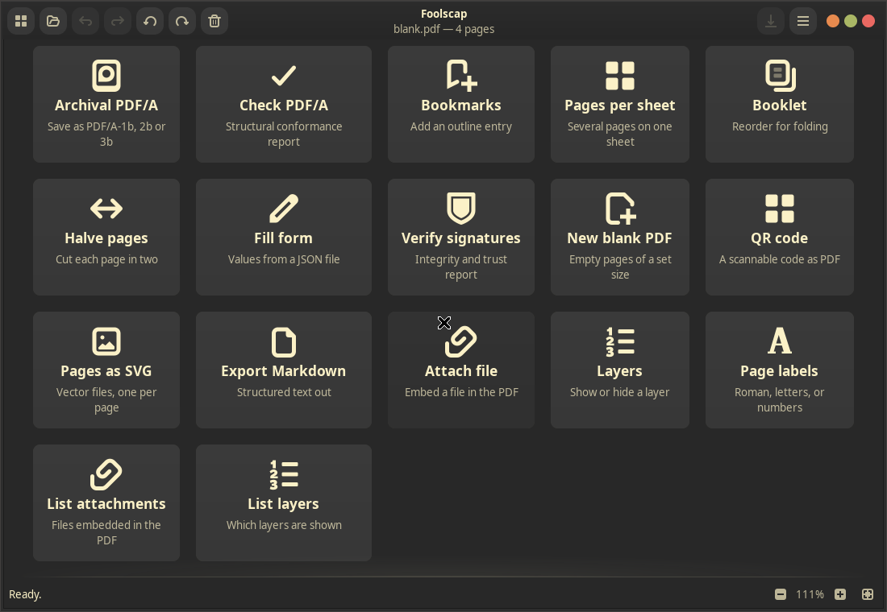
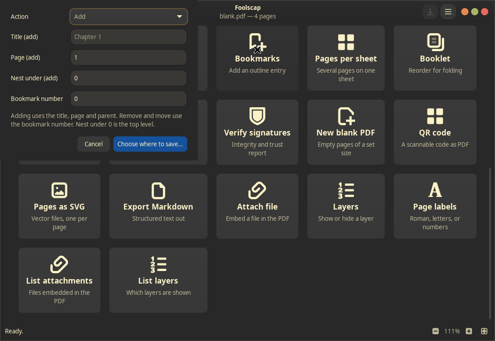

# Foolscap

[](https://github.com/Sarcastic-Soul/Foolscap/actions/workflows/ci.yml)
[](LICENSE)
[](https://www.rust-lang.org/)

A Linux-first PDF toolkit: a Rust core library with a command-line tool and a GTK4 desktop application over it.

```sh
foolscap merge a.pdf b.pdf -o out.pdf
foolscap split report.pdf --pages 1-3,7 -o out/
foolscap compress scan.pdf --level screen -o small.pdf
foolscap ocr scan.pdf -o searchable.pdf
foolscap-gui report.pdf
```

See [PLAN.md](PLAN.md) for the build history and future ideas.

## Screenshots

The dashboard puts every operation on one card:



Tools that need input open a short dialog. Here, the Bookmarks dialog adds, removes or moves an outline entry:



## At a glance

| | |
|---|---|
| Rust source | about 48,000 lines across three crates |
| Tests | 700 with every optional feature on, 399 with defaults |
| CLI subcommands | 54 |
| Dashboard tools | 37 cards |
| Git history | 36 commits on `main` |
| Licence | AGPL-3.0-or-later |

Counts are taken from the repository at the time of writing. The tests run on every push in GitHub Actions.

---

## Install

Download a file from the [Releases page](https://github.com/Sarcastic-Soul/Foolscap/releases/latest). Each release has three artifacts; pick one.

**Ubuntu 24.04 or newer, Debian 13 or newer** — the `.deb` package:

```sh
sudo apt install ./foolscap_0.1.0_amd64.deb
```

**Any distribution, with Flatpak** — the `Foolscap.flatpak` bundle:

```sh
flatpak install --user Foolscap.flatpak
flatpak run com.github.sarcastic_soul.Foolscap                     # the desktop app
flatpak run --command=foolscap com.github.sarcastic_soul.Foolscap  # the command-line tool
```

**Any distribution, without a package manager** — the tarball. It needs GTK 4.10 or newer and glibc 2.39 or newer (Ubuntu 24.04, Fedora 40 and later are fine):

```sh
tar xzf foolscap-0.1.0-x86_64-linux.tar.gz
cd foolscap-0.1.0-x86_64-linux
./install.sh                 # into ~/.local; use sudo for /usr/local
./install.sh --uninstall     # to remove it again
```

[LibreOffice](https://www.libreoffice.org/) and [Tesseract](https://github.com/tesseract-ocr/tesseract) are optional. Without them, Foolscap still merges, splits, rotates, compresses and renders; it just cannot convert office files or recognise text in scans. Install them from your distribution to turn those on (`sudo apt install libreoffice tesseract-ocr` on Ubuntu), and run `foolscap capabilities` to see what it can find. The Flatpak cannot reach either of them yet.

`SHA256SUMS` on the same page lets you check a download:
`sha256sum --check --ignore-missing SHA256SUMS`.

---

## Layout

| Path | What it is |
|---|---|
| `crates/pdf-core` | All PDF logic. No GUI or CLI dependencies. |
| `crates/foolscap-cli` | The `foolscap` command-line tool. |
| `crates/foolscap-gui` | The `foolscap-gui` GTK4 application. |
| `packaging/` | Debian and Flatpak packaging. |

The core is kept free of presentation concerns — it never prints, never exits, and reports progress through a callback — so the CLI and the desktop application call exactly the same functions.

---

## Build

Requires a stable Rust toolchain and `build-essential`.

```sh
cargo build --features foolscap-cli/full
cargo run -p foolscap-cli --features full -- capabilities
cargo run -p foolscap-gui
```

`foolscap capabilities` reports which optional features this build has and whether the external tools they need are actually installed.

### Optional features

Three capabilities are gated behind Cargo features, off by default. Each pulls in a heavy dependency or an external program, and none is needed for basic document manipulation.

| Feature | Adds | Needs |
|---|---|---|
| `render` | Page rendering, thumbnails, text extraction, HTML export | MuPDF, built from vendored sources |
| `convert` | Image and Office conversion, Markdown/HTML/Text to PDF | LibreOffice on `PATH` |
| `ocr` | Text recognition (OCR) | Tesseract on `PATH` (implies `render`) |

```sh
cargo build --features full          # everything
cargo run -p foolscap-cli --features full -- capabilities
```

The first build with `render` compiles the MuPDF C sources, which takes about twenty seconds on top of a normal build. `ocr` implies `render`, since pages are rasterised before they are recognised.

---

## Command reference

Every command reads password-protected input when given `--password`, or the password in the `FOOLSCAP_PASSWORD` environment variable, which keeps it out of shell history. Files that open without a password (an empty user password, as most restricted PDFs have) need neither. Output is always written unencrypted.

### Page operations

| Command | Description |
|---|---|
| `merge` | Concatenate documents into one. |
| `split` | Extract pages, or burst a document into pieces. |
| `rotate` | Rotate pages in place (90° increments). |
| `delete` | Remove pages. |
| `reorder` | Put pages in a different order. |
| `crop` | Crop pages to a rectangle, resize them, or restore the full page. |
| `arrange` | (internal) shared primitive for delete/reorder. |

### Inspection & metadata

| Command | Description |
|---|---|
| `info` | Show page count, file size, encryption status, and metadata. |
| `meta` | Read or edit the document information dictionary (title, author, subject, keywords, creator, producer, dates). |

### Security

| Command | Description |
|---|---|
| `decrypt` | Write an unencrypted copy of a password-protected document. |
| `encrypt` | Protect a document with a password (AES-256) and choose permissions (print, copy, modify, annotate, fill forms, accessibility, assemble, high-quality print). |

### Optimization & compression

| Command | Description |
|---|---|
| `optimize` | Lossless cleanup: deduplicate streams, drop unused objects, recompress streams with Flate. |
| `compress` | Shrink a document by resampling its images to a target resolution (screen/ebook/print). Lossy. Supports PNG-predictor and TIFF-predictor streams. |
| `strip` | Remove identifying metadata: Info entries, XMP packet, and the document ID. |
| `repair` | Rebuild a damaged cross-reference table and wrong stream lengths. |

### Rendering & images (`render` feature)

| Command | Description |
|---|---|
| `render` | Rasterise pages to PNG at a given DPI or fitted to a box. |
| `thumbnail` | Write a single small preview image of one page. |
| `overlay` | Draw one PDF over another (e.g., letterhead). |
| `extract-images` | Pull every embedded image out of a PDF. |

### Later additions

| Command | Description |
|---|---|
| `linearize` | Reorder objects so the first page loads over HTTP without the rest. |
| `to-pdfa` | Convert to PDF/A-1b, 2b or 3b, with an embedded sRGB profile. |
| `check-pdfa` | Check the structural PDF/A rules Foolscap enforces. Not a veraPDF validation. |
| `bookmark` | List, add, remove, move, import or export the outline. |
| `halve` | Cut each page into two halves, vertically or horizontally. |
| `create` | Make a blank document of a chosen page count and size. |
| `fill-form` | Fill AcroForm fields from a JSON file of `"name": value` pairs. |
| `verify-signatures` | Check digital signatures for integrity and for a chain to a system root. |
| `qr-code` | Make a one-page PDF holding a QR code. |
| `to-svg` | Export pages as vector SVG. Text is drawn as paths, so it is not selectable. |
| `to-markdown` | Extract the text as Markdown. |
| `attachments` | List, add or extract embedded files. |
| `layers` | List optional content layers, and show or hide one. |
| `page-labels` | Read or set page labels, such as roman numerals before arabic. |
| `articles` | List article threads. |

### Conversion (`convert` feature)

| Command | Description |
|---|---|
| `from-images` | Bind images into a PDF, one page per image (page size, fit mode, EXIF orientation). |
| `to-images` | Rasterise every page to an image file (PNG, JPEG, or ZIP archive). |
| `from-office` | Convert a document LibreOffice can open (DOCX, ODT, PPTX, XLSX, etc.) into a PDF. |
| `to-office` | Convert a PDF into an editable document (DOCX, PPTX, XLSX). **Approximate — warn loudly.** |
| `from-text` | Typeset a plain-text file as a PDF. |
| `from-markdown` | Typeset a Markdown file as a PDF. |
| `from-html` | Convert an HTML file into a PDF. |
| `to-html` | Convert a PDF into a single HTML file (with embedded images). |
| `to-zip` | Rasterise pages into one ZIP archive of images. |

### OCR (`ocr` feature)

| Command | Description |
|---|---|
| `ocr` | Add an invisible text layer so a scan becomes searchable. Renders at 300 DPI, runs Tesseract, grafts the text layer back over the original image (quality preserved). Skips pages that already have text. |
| `extract-text` | Read out the text a document already carries. No recognition. |

### Stamping & annotations

| Command | Description |
|---|---|
| `stamp` | Draw text or an image over or under pages (position, rotation, opacity, pages). Also invoked by the GUI's **Watermark** card. |
| `watermark` | Draw a large translucent mark, diagonally by default. (GUI card: **Watermark** → CLI `stamp`) |
| `page-numbers` | Draw running page numbers (format, position, start, range). |
| `header-footer` | Draw a running header and/or footer with templates (`{page}`, `{total}`, `{date}`, `{title}`, `{file}`). |
| `flatten` | Bake form fields and annotations into the page content (optionally keep non-form annotations). |
| `filter` | Recolour embedded images (grayscale, sepia, invert, threshold). Vector text is left alone. |
| `redact` | Cover an area or a found string so it is neither visible nor searchable. Cuts glyphs out of text streams, blanks covered image pixels, removes small vector paths. |
| *(GUI only)* | **Sign** — draw or type a signature on pages (no CLI equivalent). |

---

## GUI: `foolscap-gui`

A GTK4 desktop application with:

- **Document view**: scrolling page renderer backed by MuPDF, with thumbnail sidebar.
- **Page operations on selection**: rotate, delete, reorder by drag-and-drop.
- **Merge via file drop**: drop one PDF to replace, drop multiple to merge in order.
- **Dashboard**: a grid of tool cards covering every operation (Merge, Split, Compress, OCR, Extract Text/HTML, Images↔PDF, Office↔PDF, Text/Markdown→PDF, Encrypt, Watermark, Page Numbers, Crop/Resize, Redact, Flatten, Sign). Cards grey out with a tooltip explaining why (missing document, missing Tesseract/LibreOffice, or feature not compiled in). *Sign is GUI-only (draw/type a signature); all other cards map to a CLI command.*
- **Export dialog**: wraps compress and to-images with format options.
- **Compare view**: two documents side by side with synchronized scrolling/zoom and a pixel-diff overlay.
- **Job queue**: long-running tasks (OCR, compress, conversions) run on a worker thread with progress bars; queue shows status, allows cancelling waiting jobs, clearing finished ones.
- **Undo/Redo**: full history with keyboard shortcuts (Ctrl+Z / Ctrl+Shift+Z).
- **Password prompt**: encrypted documents ask for a password in a dialog.
- **Keyboard shortcuts**: Ctrl+O (open), Ctrl+S (save), Ctrl+Shift+S (save as), Ctrl+W (close), Ctrl+Z (undo), Ctrl+[ / Ctrl+] (rotate), Delete (delete pages), Ctrl++ / Ctrl+- (zoom), Ctrl+0 (fit width), Ctrl+D (dashboard), Ctrl+? (shortcuts window), Ctrl+Alt+1/2 (compare open), Ctrl+Alt+S (sync compare), Ctrl+Alt+D (diff compare), Ctrl+Shift+Esc (cancel waiting).

---

## Development

```sh
ALL=--features foolscap-cli/full,pdf-core/render,pdf-core/convert,pdf-core/ocr

cargo fmt
cargo clippy --all-targets --workspace $ALL -- -D warnings
cargo test --workspace $ALL
```

Clippy must be clean before every commit. Tests that need LibreOffice or Tesseract skip themselves when the tool is absent.

### Project structure

```
Foolscap/
├── Cargo.toml              # workspace manifest
├── Cargo.lock              # committed (this is an application)
├── LICENSE                 # AGPL-3.0
├── README.md
├── PLAN.md                 # build history & future ideas
├── rust-toolchain.toml     # pins the toolchain channel
├── .gitignore
├── crates/
│   ├── pdf-core/           # all logic; no GUI, no clap
│   │   ├── Cargo.toml
│   │   └── src/
│   │       ├── lib.rs
│   │       ├── error.rs
│   │       ├── document.rs
│   │       ├── pages.rs
│   │       ├── assemble.rs
│   │       ├── placement.rs
│   │       ├── progress.rs
│   │       ├── subprocess.rs
│   │       ├── text.rs
│   │       ├── render/
│   │       ├── ocr/
│   │       ├── convert/
│   │       └── ops/        # one module per operation
│   └── foolscap-cli/       # thin argument parsing over pdf-core
│       ├── Cargo.toml
│       └── src/
│           ├── lib.rs
│           ├── main.rs
│           ├── output.rs
│           └── commands/
└── packaging/
    ├── build-deb.sh
    ├── build-tarball.sh
    ├── install.sh
    ├── com.github.sarcastic_soul.Foolscap.metainfo.xml
    ├── com.github.sarcastic_soul.Foolscap.desktop
    └── foolscap.svg
```

### Core API principles (for contributors)

- Every fallible function returns `Result<_, PdfError>`; `PdfError` is a `thiserror` enum, never a boxed string.
- No `println!` or `eprintln!` anywhere in `pdf-core`. Use the `tracing` crate; the CLI installs a subscriber, the GUI installs a different one.
- Long operations take an optional progress callback (`&mut dyn FnMut(Progress)`) rather than driving a progress bar themselves.
- Nothing in `pdf-core` calls `std::process::exit`.
- The GUI depends on `pdf-core` directly, not on shelling out to the CLI.

---

## Packaging

```sh
./packaging/build-deb.sh        # target/debian/foolscap_<version>_amd64.deb
./packaging/build-tarball.sh    # target/tarball/foolscap-<version>-x86_64-linux.tar.gz
```

See [packaging/README.md](packaging/README.md) for the Flatpak and for how a release is made.

### Generated assets

Man pages and shell completions (bash, zsh, fish) are generated from the same `clap` definition the binary uses, so they cannot drift from the real flags:

```sh
cargo run -p foolscap-cli --example generate-assets --features full -- dist
```

---

## License

AGPL-3.0-or-later, matching MuPDF. See [LICENSE](LICENSE).

LibreOffice and Tesseract are run as subprocesses, never linked, so their licences do not reach Foolscap.

---

## Acknowledgments

Built on excellent open-source foundations:

- [lopdf](https://github.com/J-F-Liu/lopdf) — low-level PDF manipulation
- [mupdf](https://mupdf.com/) / [mupdf-rs](https://github.com/mupdf/mupdf-rs) — rendering, text extraction, encryption
- [printpdf](https://github.com/printpdf/printpdf) — PDF generation (images→PDF)
- [image](https://github.com/image-rs/image) — image decoding, resampling, encoding
- [gtk4-rs](https://gtk-rs.org/) — GUI bindings
- [clap](https://github.com/clap-rs/clap) — CLI parsing
- [tracing](https://github.com/tokio-rs/tracing) — structured logging
- LibreOffice & Tesseract — external converters (run as subprocesses)